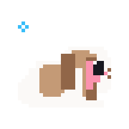

# `rpatty` 🐇

**Agency Operator &bull; Full-Stack Systems Architect &bull; Automation Engineer &bull; Nitech**

*Professional larper.*

 

  

  
  
  

  

 

  

---

### 🐰 About & What I Build

Hey! I’m **rpatty**, operating at **[Nitech](https://nitech.dev)**.

I don’t just write code — I build and run full-cycle businesses:
- **Agencies & Growth:** Scaling client acquisition, brand ops, and high-converting paid traffic campaigns (Facebook & Meta Ads) backed by deep tracking and attribution.
- **Analytics & Data Pipelines:** Custom revenue dashboards, conversion analytics, event tracking, and telemetry infrastructure that tell you the truth about your numbers.
- **Everyday Life & Smart Home Automation:** Designing frictionless IoT ecosystems, local-first home automations, autonomous schedulers, and background daemons that handle daily routines silently.
- **Zero-Dependency Systems & APIs:** High-speed, lightweight backend engines, raw network protocol handlers (UDP/TCP/SNMP), and resilient state-machines built with zero third-party bloat.

And of course, professional larper. 🐇

---

### 🛠️ Capabilities & Tech Matrix

<table>
  <thead>
    <tr>
      <th align="left" width="30%">Focus Area</th>
      <th align="left" width="45%">What I Deliver</th>
      <th align="left" width="25%">Tools &amp; Stack</th>
    </tr>
  </thead>
  <tbody>
    <tr>
      <td><strong>📈 Agency &amp; Paid Media</strong></td>
      <td>Media buying, Facebook Ads scaling, campaign architecture, conversion tracking, creative testing frameworks, and client acquisition funnels.</td>
      <td><code>Meta Ads Manager</code> &bull; <code>Conversions API</code> &bull; <code>Attribution</code></td>
    </tr>
    <tr>
      <td><strong>📊 Business Analytics</strong></td>
      <td>Real-time business dashboards, custom event ingestion, Cohort retention, profit tracking, and automated reporting.</td>
      <td><code>PostgreSQL</code> &bull; <code>SQLite WAL</code> &bull; <code>Redis</code> &bull; <code>Chart.js</code></td>
    </tr>
    <tr>
      <td><strong>🏠 Smart Home &amp; Life Automations</strong></td>
      <td>Frictionless everyday automations, local IoT controls, ambient sensors, task orchestration, and scheduled daemon routines.</td>
      <td><code>Home Automation</code> &bull; <code>Webhooks</code> &bull; <code>cron/Task Scheduler</code></td>
    </tr>
    <tr>
      <td><strong>⚡ APIs &amp; Low-Level Protocols</strong></td>
      <td>Zero-dependency RFC implementations, raw socket servers, async REST microservices, and autonomous background sentinels.</td>
      <td><code>Python (Asyncio)</code> &bull; <code>FastAPI</code> &bull; <code>Raw Sockets</code> &bull; <code>SNMP</code></td>
    </tr>
    <tr>
      <td><strong>🖥️ Full-Stack &amp; Desktop Tools</strong></td>
      <td>Snappy, responsive web apps, internal company portals, and native Windows automation utilities.</td>
      <td><code>TypeScript</code> &bull; <code>React</code> &bull; <code>TailwindCSS</code> &bull; <code>C# / .NET</code></td>
    </tr>
  </tbody>
</table>

---

### 🐇 Activity

  

---

  
Built with care at <strong>Nitech</strong> 🐇 &bull; High signal, zero fluff.

  🌐 <a href="https://nitech.dev">nitech.dev</a> &bull; ✉️ <a href="mailto:info@nitech.dev">info@nitech.dev</a> &bull; 💼 <a href="https://github.com/rpatty-dev">github.com/rpatty-dev</a>

