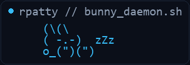

# `rpatty` 🐇

**Agency Operator &bull; Full-Stack Systems Architect &bull; FiveM & Game Systems Engineer &bull; Nitech**

*Professional larper. Chief Bunny Officer: **Leroy**.*

 

  
  &nbsp;&nbsp;
  
  &nbsp;&nbsp;
  
  &nbsp;&nbsp;
  
  &nbsp;&nbsp;
  

  
  
  

  

 

  

---

### 🐰 About & What I Build

Hey! I’m **rpatty**, operating at **[Nitech](https://nitech.dev)** alongside Leroy the lop rabbit. 🐇

I don’t just write code — I build, deploy, and operate high-impact production software, game systems, and growth businesses:
- **FiveM & Multiplayer Game Development:** Architecting low-latency game scripts, custom framework extensions (QBox, QB-Core, ESX), interactive UI minigames, custom economy loops, and server-side synchronization engines.
- **Agencies & Paid Media:** Scaling client acquisition, brand operations, and high-converting paid traffic engines (Meta/Facebook Ads) with custom tracking, conversion API wiring, and campaign architecture.
- **Internal Tools & Field Operations:** Turning tedious paper workflows, inspections, repair jobs, and field team processes into automated, click-and-done mobile web apps.
- **Hardware Protocols & Zero-Dependency Sentinels:** Autonomous daemons that interface directly with raw UDP/TCP sockets, SNMP MIBs, and telemetry APIs with zero third-party library overhead.
- **Custom Browser Extensions & Automation Scripts:** Custom Tampermonkey/userscripts and Chrome extensions that accelerate enterprise CRM, ERP, and dispatch systems by 10x.
- **Smart Home & Everyday Automations:** Frictionless IoT orchestration, ambient sensor monitoring, and automated background schedulers.

And of course, professional larper. 🐇

 

  
  &nbsp;&nbsp;
  

---

### 🐰 Custom Agents building with me:

| `agent-ideation` | `agent-executor` | `agent-deployer` | `agent-evaluator` | `agent-debugger` |
| :---: | :---: | :---: | :---: | :---: |
|  `agent-ideation` |  `agent-executor` |  `agent-deployer` |  `agent-evaluator` |  `agent-debugger` |

| `agent-sentinel` | `agent-builder` | `agent-optimizer` | `agent-watcher` | `agent-linter` |
| :---: | :---: | :---: | :---: | :---: |
|  `agent-sentinel` |  `agent-builder` |  `agent-optimizer` |  `agent-watcher` |  `agent-linter` |

 

<b>🔍 Phase 1: Ingestion & Architecture &bull; <code>agent-ideation</code> & <code>agent-evaluator</code></b>

 

- **`agent-ideation` &bull; Spec Ingestion & Roadmap Architect**
  - **Triggers:** RFC drop, new feature issue, client requirements intake.
  - **Stack & Tools:** Markdown AST parsers, dependency graph analyzers, task-breakdown pipelines.
  - **Output:** Phased execution tracks, API interface contracts, dependency constraints.
- **`agent-evaluator` &bull; Human-in-the-Loop & Evaluation Harness**
  - **Triggers:** Pull request readiness, design divergence, critical security boundaries.
  - **Stack & Tools:** Pre-commit evaluation runners, diff assertion verifiers, interactive review hooks.
  - **Output:** Blocking review signals, design approval verdicts, alignment audits.

<b>💻 Phase 2: Core Execution & Compilation &bull; <code>agent-executor</code> & <code>agent-builder</code></b>

 

- **`agent-executor` &bull; Low-Latency Systems & Application Engineer**
  - **Triggers:** Phase implementation tickets, active feature coding tasks.
  - **Stack & Tools:** FiveM Lua 5.4 / QBox runtimes, Python 3.12, TypeScript / React / Vite, Tailwind CSS.
  - **Output:** Production scripts, zero-dependency server modules, responsive NUI frontends.
- **`agent-builder` &bull; Asynchronous Background Compilation Daemon**
  - **Triggers:** Asset bundling events, Docker build chains, cross-platform packaging.
  - **Stack & Tools:** Vite / esbuild / Rollup, cargo / rustc workers, background daemon supervisors.
  - **Output:** Optimized client bundles, production artifacts, container images.

<b>🥞 Phase 3: Vulnerability & Root-Cause Analysis &bull; <code>agent-sentinel</code> & <code>agent-debugger</code></b>

 

- **`agent-sentinel` &bull; CVE & Regressions Watchdog**
  - **Triggers:** Git push pre-validation, periodic dependency scans, memory leak detection.
  - **Stack & Tools:** SAST scanners, raw UDP network probes, secret-leak scanners, AST analyzers.
  - **Output:** Vulnerability reports, tainted input trace alerts, automated patch triggers.
- **`agent-debugger` &bull; Hotfix & Root-Cause Dissector**
  - **Triggers:** Uncaught exceptions, failing test assertions, telemetry anomaly alerts.
  - **Stack & Tools:** Core dump inspection, stack trace bisectors, headless browser runners.
  - **Output:** Minimal reproducing test cases, surgical patch commits, regression prevention notes.

<b>⚡ Phase 4: Runtime Performance & Hygiene &bull; <code>agent-optimizer</code> & <code>agent-linter</code></b>

 

- **`agent-optimizer` &bull; Micro-Optimizations & Latency Profiler**
  - **Triggers:** High tick-rate loops, slow query telemetry, frame-time spikes (>5ms).
  - **Stack & Tools:** Profilers (cProfile, perf), Redis cache tiering, SQL indexing tuners.
  - **Output:** Sub-millisecond tick optimizations, optimized DB query plans, cache hit ratios.
- **`agent-linter` &bull; Code Hygiene & Technical Debt Janitor**
  - **Triggers:** Post-merge maintenance, linting hooks, orphan dependency detection.
  - **Stack & Tools:** ESLint, Ruff, ShellCheck, tree-shaking dead-code analyzers.
  - **Output:** Automated code cleanup, zero-warning builds, strict style adherence.

<b>🚀 Phase 5: Release & Continuous Observability &bull; <code>agent-deployer</code> & <code>agent-watcher</code></b>

 

- **`agent-deployer` &bull; Production Release & CD Pipeline**
  - **Triggers:** All test checks passed, semantic version bumps, release tags.
  - **Stack & Tools:** GitHub Actions, Git release tags, automated changelog pipelines, server hooks.
  - **Output:** Verified zero-downtime production deployments, published artifacts.
- **`agent-watcher` &bull; Daemon Sentinel & Telemetry Observer**
  - **Triggers:** Continuous 24/7 background service monitoring.
  - **Stack & Tools:** Raw UDP socket pingers (RFC 3805/1514), SNMP telemetry loops, REST heartbeat monitors.
  - **Output:** Real-time uptime telemetry, low-supply inventory alerts, automatic failover actions.

---

### 🚀 Featured Repositories & Sentinel Platforms

&nbsp;

  

&nbsp;

---

### 🚀 Selected Systems & Tools Built

A portfolio of custom production tools, FiveM game engines, field automation apps, hardware sentinels, and growth engines built across enterprise operations and client projects:

#### 🎮 FiveM Multiplayer Scripting & Game Engines (QBox / QB-Core)
- **Vehicle Boosting & Contract System (`rpa-boosting`):** Dynamic Tier-based vehicle hacking, VIN scratching, police dispatch triggers, and GPS tracker removal minigames.
- **Emergency Services Sync & Blips (`rpa-ems-police-blips`):** High-frequency server-synced map markers, callout routing, unit status indicators, and department radio channels.
- **Underground Smuggling & Economy Loops (`rpa-fegsmuggle` & `rpa-reddiesel`):** Custom illegal transport routes, fuel-siphoning mechanics, contraband inspection systems, and laundering networks.
- **Target Interaction Suites (`rpa-thirdeyepolice` & `rpa-admin`):** Context-aware entity targeting (ox_target/qb-target), duty toggles, impound dispatch, and live administrator management menus.
- **Minigame & Utility Modules (`rpatty-dumpster`, `rpattynitrous`, `lockpick-fix`):** Skill-check UI minigames, synchronized vehicle nitrous purges, and server-wide lockpicking overhauls.

#### 📡 Hardware Sentinels & Telemetry Daemons
- **PrinterPing:** Pure-Python zero-dependency SNMP supply monitor (RFC 3805/1514). Polls raw UDP 161 sockets, tracks multi-toner and imaging drum levels, cross-references storeroom spare inventory, and triggers automated low-supply alerts.
- **MOTPing:** Autonomous vehicle compliance engine and REST sentinel querying government DVSA/DVLA APIs for automated fleet road tax and inspection schedules with instant SMS/email reminders.
- **Fleet Telemetry & Intake (Pitlane):** High-speed workshop intake and vehicle repair platform with real-time technician workflows, parts tracking, and automated service logging.
- **Van Tracker & GPS Sentinel:** Real-time multi-vehicle GPS fleet tracking portal with route playback, speed telemetry, geofencing, and driver shift logs.

#### 🏢 Enterprise Operations & Field Automation
- **Job Summary Maker:** Automated job sheet generator converting messy field technician notes and raw work orders into standardized, client-ready completion summaries in seconds.
- **Fire Door Compliance Checklist:** Digital mobile inspection suite for certified fire door safety audits, photo documentation, tolerance logging, and instant compliance PDF generation.
- **Field Emergency Response App:** Rapid incident logging, job dispatch, and site hazard tracking platform designed for fast-paced field operations and emergency work orders.
- **Van Mechanic Logger:** Dedicated workshop maintenance ledger recording vehicle service histories, parts consumed, MOT repairs, and preventive maintenance milestones.
- **Asset Sizing & Fabrication Estimator:** Custom parametric calculation engine for sizing, estimating, and spec’ing structural fabrication components and safety grates.

#### ⚡ Workflow Acceleration & Custom Browser Engines
- **Enterprise ERP Quick Job Search:** Fast keyboard-driven indexer and search utility that shortcuts slow legacy housing management software to retrieve work orders in under 50ms.
- **ERP Error Resolver & Diagnostic Tool:** Intelligent error parsing tool that decodes ambiguous enterprise database exception codes into actionable one-click resolution steps.
- **Portal Automation Extension (Tampermonkey):** High-efficiency userscript injecting instant hotkeys, auto-filling claim submissions, and bypassing repetitive form fields in housing portals.
- **Commercial Property Scraping & Search Extension:** Chrome extension extracting live commercial property listings, tenancy data, and yield metrics directly from property portals into structured spreadsheets.
- **Contractor Claims Processor:** Batch processing engine that audits contractor job completion data, reconciles line items against schedule-of-rates (SOR) codes, and exports clean invoice claims.

#### 📈 Growth, Agency & Marketing Operations
- **Paid Ads Acquisition Engine (Meta/Facebook):** Full-funnel campaign architectures, creative iteration pipelines, and custom conversion tracking for agency lead generation.
- **Automated Newsletter Publisher:** Dynamic newsletter engine formatting weekly client updates, announcements, and promotional assets into clean responsive HTML templates.
- **Social Media Content Pipeline:** Multi-channel asset preparation tool organizing campaign graphics, caption presets, and publishing schedules for consistent branding.
- **Interactive Security & CCTV Coverage Mapper:** Interactive visual map overlaying site plans with camera sightlines, coverage zones, and hardware specs for client security pitches.
- **Fuel Price Intelligence Tracker:** Automated scraper and comparison tool tracking regional fuel prices across commercial filling stations to optimize fleet routing and fuel spend.

---

### 🛠️ Capabilities & Tech Matrix

<table>
  <thead>
    <tr>
      <th align="left" width="28%">Domain</th>
      <th align="left" width="46%">What I Deliver</th>
      <th align="left" width="26%">Tools &amp; Stack</th>
    </tr>
  </thead>
  <tbody>
    <tr>
      <td><strong>🎮 FiveM &amp; Game Scripts</strong></td>
      <td>Server-authoritative game loops, QBox/QB-Core resources, ox_target interactions, NUI webviews, and synchronized multiplayer events.</td>
      <td><code>Lua 5.4</code> &bull; <code>QBox / QB-Core</code> &bull; <code>NUI / HTML / JS</code> &bull; <code>oxmysql</code></td>
    </tr>
    <tr>
      <td><strong>📈 Agency &amp; Paid Media</strong></td>
      <td>Media buying, Meta/Facebook Ads scaling, campaign architecture, CAPI conversion tracking, and high-intent acquisition funnels.</td>
      <td><code>Meta Ads Manager</code> &bull; <code>Conversions API</code> &bull; <code>Attribution</code></td>
    </tr>
    <tr>
      <td><strong>⚡ APIs &amp; Network Protocols</strong></td>
      <td>Zero-dependency RFC implementations, raw UDP/TCP socket servers, async REST microservices, and autonomous background sentinels.</td>
      <td><code>Python (Asyncio)</code> &bull; <code>FastAPI</code> &bull; <code>Raw Sockets</code> &bull; <code>SNMP</code></td>
    </tr>
    <tr>
      <td><strong>📊 Business Analytics &amp; Data</strong></td>
      <td>Real-time operational dashboards, custom event ingestion, SQL analytics, fleet telemetry, and automated performance reporting.</td>
      <td><code>PostgreSQL</code> &bull; <code>SQLite WAL</code> &bull; <code>Redis</code> &bull; <code>Chart.js</code></td>
    </tr>
    <tr>
      <td><strong>🖥️ Full-Stack &amp; Field Apps</strong></td>
      <td>Mobile-first inspection apps, snappy responsive web portals, and terminal-grade responsive design systems.</td>
      <td><code>TypeScript</code> &bull; <code>React</code> &bull; <code>TailwindCSS</code> &bull; <code>Next.js</code></td>
    </tr>
    <tr>
      <td><strong>🧩 Browser Extensions &amp; Scripts</strong></td>
      <td>Custom Chrome extensions (Manifest V3) and Tampermonkey automations that accelerate enterprise ERPs and portal workflows.</td>
      <td><code>JavaScript</code> &bull; <code>DOM Manipulation</code> &bull; <code>Userscripts</code></td>
    </tr>
    <tr>
      <td><strong>🏠 Smart Home &amp; Automation</strong></td>
      <td>Frictionless everyday automations, local IoT controls, ambient sensors, task orchestration, and scheduled daemon routines.</td>
      <td><code>Home Automation</code> &bull; <code>Webhooks</code> &bull; <code>PowerShell / Bash</code></td>
    </tr>
  </tbody>
</table>

---

### 🐇 Activity

  

---

  
Built with care at <strong>Nitech</strong> 🐇 &bull; Chief Bunny Officer: <strong>Leroy</strong>.

  🌐 <a href="https://nitech.dev">nitech.dev</a> &bull; ✉️ <a href="mailto:info@nitech.dev">info@nitech.dev</a> &bull; 💼 <a href="https://github.com/rpatty-dev">github.com/rpatty-dev</a>

